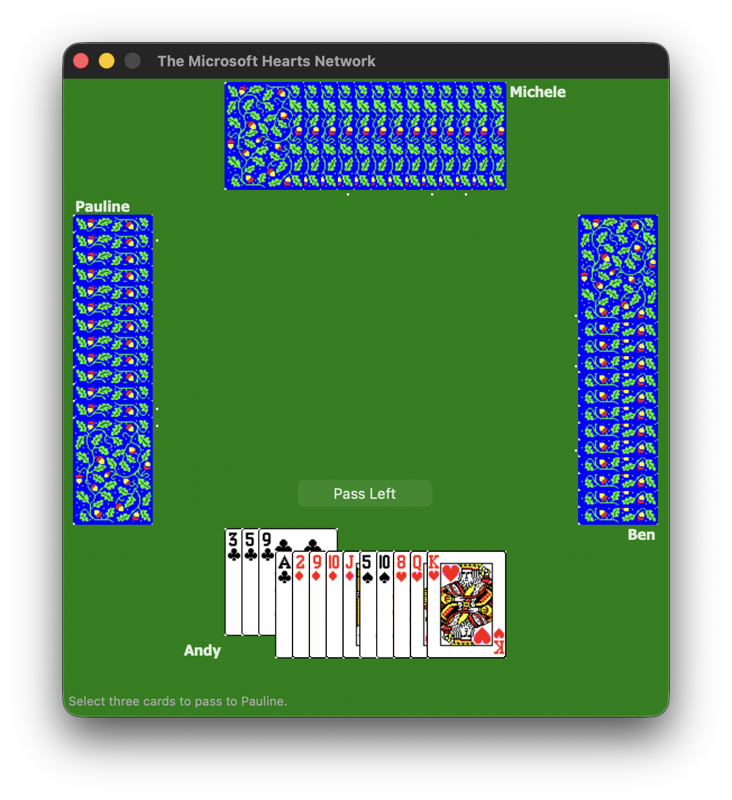
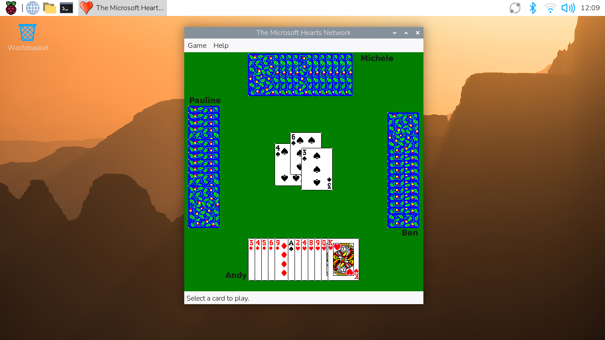
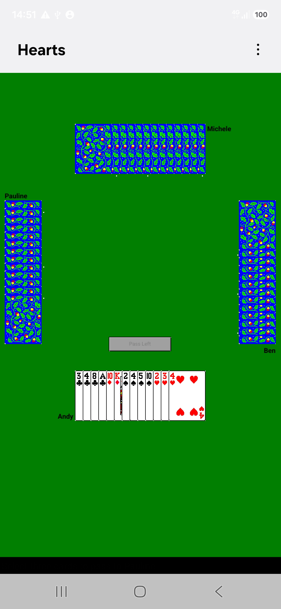

# wxhearts

A cross-platform port of Microsoft Hearts built with [wxWidgets](https://www.wxwidgets.org/). Runs on Windows, macOS, Linux, Android and classic Mac OS (68k and PowerPC).

## Screenshots

### Windows


### macOS


### Linux


### Android


## Building

### Prerequisites

- CMake 3.14+
- C++17 compiler
- wxWidgets (with `core`, `base`, `xrc`, `html`, `xml` components)
- `wxrc` tool (ships with wxWidgets)

### Build steps

```bash
mkdir build && cd build
cmake ..
cmake --build .
```

On macOS this produces a `wxhearts.app` bundle. On Linux the binary can be installed system-wide:

```bash
cmake --install .
```

### Classic Mac OS (68k and PowerPC)

Built with the [Retro68](https://github.com/autc04/Retro68) toolchain
(installed in `/opt/retro68`) and its wxRetro68 port of wxWidgets, plus a host
`wxrc`:

```bash
retro68/build.sh            # or: RETRO68=/path/to/retro68 retro68/build.sh out-dir
```

This builds the 68k and PowerPC applications and merges them into a single
fat application, `build-retro68/Hearts.dsk` (an HFS disk image for Basilisk II,
SheepShaver, QEMU or a real Mac) and `build-retro68/Hearts.bin` (MacBinary).
It needs System 7 or later with 32-bit QuickDraw. The classic Mac icons in
`retro68/icons.r` are generated from `icons/sizes` by `retro68/make-icons.py`.

To test unattended in Basilisk II, build with tracing and run it from a copy
of a System 7/8 boot disk (`BOOT_DISK`, default `~/MacROM/HD.img`; the
original is not modified):

```bash
HEARTS_CMAKE_ARGS=-DHEARTS_TRACE=ON retro68/build.sh build-trace
retro68/run-basilisk.sh build-trace/m68k/Hearts.bin
```

The trace build logs its startup to `wxtest.log` and shuts the Mac down 25
seconds after its window appears; the script prints the log and keeps
screenshots in its work directory.

## License

GPL-2.0
